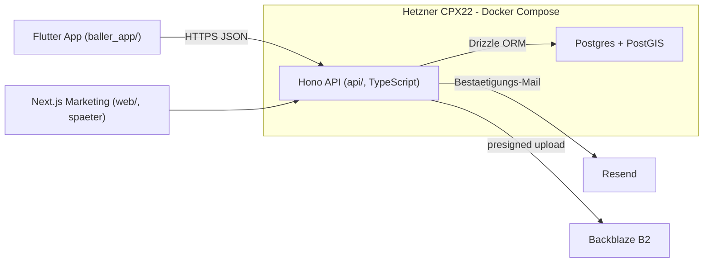

# BallerApp Neustart

Ziel dieses Tasks: **Repo saeubern und Stack definieren - NICHT bauen.** Gleiches Repo, gleiches Agent-Setup (`.claude/`, `.cursor/`, `.caliber`), alle Docs/MD, `scripts/` und Env-Tokens bleiben erhalten. Alter App- und Backend-Code wird entfernt; der neue Stack wird nur in ADRs/Regeln/Docs **festgelegt**. Backend und App baust du spaeter strukturiert.

Festgelegter Stack: **Flutter** (App) + **Node/Hono (TypeScript)** (API) + **Postgres/PostGIS** self-hosted auf Hetzner + **eigenes Auth + Resend** (Bestaetigungsmails) + **Backblaze B2** (Bilder, presigned). Vorgehen: erst sichern & saeubern, dann designen/vermarkten, dann strukturiert bauen.

## Ziel-Architektur

## Phase 0 - Sicherung (zuerst, nicht-destruktiv)

Kritisch und unwiderruflich-relevant, daher vor jedem Loeschen.

- **Archiv-Branch + Tag**: aktuellen Stand als `archive/v1-flutter-fastapi` Branch und Tag sichern, damit alles jederzeit rueckholbar ist.
- **Daten exportieren** aus lokalem Docker-Postgres (Container des `backend/`-Stacks) per `pg_dump` (Schema + Data) fuer `users`, `profiles`, `courts`, `court_images`, `refresh_tokens` (siehe Schema [backend/migrations/001_initial.sql](backend/migrations/001_initial.sql)). Ablage in `backups/` (gitignored) und zusaetzlich ausserhalb des Repos.
- **Env-Tokens sichern**: [backend/.env](backend/.env) bleibt auf Platte erhalten (gitignored), inkl. **Backblaze B2**-Keys, JWT-Secret und DB-Credentials. Mapping fuer eine neue `api/.env`-Struktur wird dokumentiert - du musst nichts neu generieren.
- **Secrets rotieren (Sicherheits-Fund)**: [.cursor/mcp.json](.cursor/mcp.json) enthaelt im Klartext einen echten GitHub PAT und einen Stitch API Key und ist in Git eingecheckt. Diese Tokens rotieren, `mcp.json` aus dem Tracking nehmen bzw. Tokens via Env referenzieren und in `.gitignore` ergaenzen.

## Phase 1 - Repo cleanen (History behalten)

- **Behalten**: `.claude/`, `.caliber`-Config, `.cursor/`, `docs/`, `scripts/`, [CLAUDE.md](CLAUDE.md), [README.md](README.md), `CALIBER_LEARNINGS.md`, `.gitignore`, `package.json` (npm-Ops/Playwright).
- **Entfernen**: `baller_app/` (alt), `backend/` (FastAPI alt), altes [docker-compose.yml](docker-compose.yml), `node_modules/`-Artefakte nach Bedarf.
- Loeschung als eigener Commit, sodass der Schnitt sauber in der History sichtbar ist (Wiederherstellung via `archive/`-Branch jederzeit moeglich).

## Phase 2 - Stack DEFINIEREN (kein Bau)

Nur Technologie-Entscheidungen festhalten - kein Backend/App-Code.

- **Neue ADRs** in `docs/decisions/`: Stack-Entscheid (Flutter + Hono/TS + Postgres/PostGIS + eigenes Auth + Resend + **Backblaze B2**, self-host Hetzner). Alte [docs/decisions/0011-fastapi-postgres-b2-backend.md](docs/decisions/0011-fastapi-postgres-b2-backend.md) als *superseded* markieren; Repository-Pattern-ADR (ADR-0008) bleibt gueltig.
- **Datenmodell- und Feature-Plan** als Markdown skizzieren (Courts, Profiles, spaeter Ranked/Turniere) - als Grundlage fuer die spaetere Bau-Phase, ohne Code.

## Phase 3 - Agent-Config & Docs angleichen

- **Agent-Regeln aktualisieren**: FastAPI/Supabase-spezifische Rules ersetzen durch Hono/Drizzle/Resend/B2-Konventionen. Betroffen u.a. [.cursor/rules/stack-fastapi-baller-backend.mdc](.cursor/rules/stack-fastapi-baller-backend.mdc), [.cursor/rules/backend-api.mdc](.cursor/rules/backend-api.mdc), [.cursor/rules/stack-supabase.mdc](.cursor/rules/stack-supabase.mdc), [CLAUDE.md](CLAUDE.md), sowie Skills unter `.claude/skills/` und `.cursor/skills/`.
- **Docs-Index** [docs/README.md](docs/README.md) und `docs/architecture/` auf neuen Stack umschreiben.
- **`.caliber`-Config** beibehalten; nach Config-Aenderungen `caliber refresh` laufen lassen, damit Cursor/Claude synchron bleiben.

## Phase 4 - scripts/ ans neue Repo anpassen

- `scripts/` bleibt erhalten und wird an die neue Struktur angepasst: `scripts/deploy/` (z.B. [scripts/deploy/pull-and-redeploy.mjs](scripts/deploy/pull-and-redeploy.mjs)), `scripts/config/` ([scripts/config/deploy.example.json](scripts/config/deploy.example.json)), `scripts/hooks/`, [scripts/index.mjs](scripts/index.mjs).
- Pfad- und Stack-Annahmen (FastAPI `backend/`, altes `docker-compose.yml`) auf die neue Backend-Struktur und den neuen Compose-/Deploy-Flow umstellen - ohne den Backend-Bau vorwegzunehmen.
- [docs/scripts/README.md](docs/scripts/README.md) und npm-Skripte in [package.json](package.json) entsprechend aktualisieren.

## Spaeter (NICHT Teil dieses Tasks)

- Backend bauen (Hono + Drizzle + eigenes Auth + Resend + B2-presign) - strukturiert in eigener Session.
- Daten-Import in das neue Schema (Export aus Phase 0 mappen, Row-Counts validieren).
- Flutter-App in `baller_app/` neu aufsetzen (Design-System, Repository-Pattern, ApiClient).
- Optionale `web/`-Marketing-Site.

## Offene Punkte

- Verzeichnisname Backend: `api/` (statt altem `backend/`) vorgeschlagen; bei Wunsch `backend/` beibehaltbar - wird beim spaeteren Bau final entschieden.

